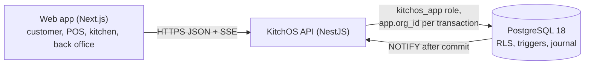

# KitchOS

KitchOS is a multi-tenant restaurant operating system for quick-service chains: ordering, kitchen
production, stock, cash handling and the books, in one system with one source of truth. It is under
active development, built as vertical slices on real PostgreSQL persistence, with the important
rules enforced by the database and checked by tests against persisted state.

> **Status (November 2026):** 19 milestones committed. Ordering, POS, kitchen, inventory, cash
> drawers, shifts, a double-entry journal, business-day close and food cost reporting work end to
> end. Workforce, purchasing, offline store operation and hosted deployment have not been started.
> See the [feature matrix](docs/FEATURE_MATRIX.md) for the status of each capability with evidence.

## Why it exists

Restaurant software is usually several products joined by exports: a POS, a kitchen display, a
stock tool and an accounting package. Each keeps its own copy of the truth, and the gaps show up as
stock that never reconciles, cash that cannot be traced to a person, and food cost known only weeks
later. KitchOS keeps those records together and makes them agree by construction:

- every physical stock change is one immutable ledger row, recorded exactly once;
- every stock movement carries its value, and the journal is posted from the same facts, so the
  Inventory account reconciles to the stock ledger to the cent each business day;
- cash is always tied to a drawer session and a person, counted blind, and closed into the books.

## What works today

Implemented means persisted in PostgreSQL, enforced by the server, covered by tests that check
persisted state, and documented. The [feature matrix](docs/FEATURE_MATRIX.md) lists the evidence.

- **Tenancy and access:** organisation, brand, region and restaurant hierarchy; PostgreSQL
  row-level security on every table; roles scoped to any level of the hierarchy; 404 for anything
  in another tenant.
- **Menus:** versioned, immutable menus and recipes with modifiers, combos and availability.
- **Ordering:** guest web ordering and staff POS entry, server-side GST-inclusive pricing,
  idempotent placement, reservations that cannot oversell under concurrency, sandbox card payments,
  cash tender with 5c rounding, park, recall and void.
- **Discounts and approvals:** percentage and amount discounts, staff and complimentary meals, and
  single-use manager overrides bound to the exact discount.
- **Kitchen:** station routing including combo components, versioned and idempotent task commands,
  live updates over server-sent events with a polling fallback, expo and a public pickup board.
- **Refunds:** by amount or by item, card or cash, with per-line GST and refunded food recorded as
  waste.
- **Inventory:** append-only ledger with a reconciled balance projection, configurable consumption
  point per recipe, waste with approval thresholds and reversal, goods receipts, physical counts,
  standard-cost valuation, and transfers between restaurants with receipt, shortage and postings
  through a Stock in transit account (ADR-0019).
- **Cash:** drawers, till sessions, float, paid in and out, safe drops, blind counts and variance
  approval by someone independent; shifts across several drawers and people with an immutable
  close snapshot.
- **Finance:** balanced, append-only journal posted from domain events; trial balance and
  reconciliation per tender and per entry; business-day close with server-enforced blockers; food
  cost, gross profit and recipe cost by day, menu item and category.

## Under development

No milestone is in progress. The next items in the
[implementation plan](docs/IMPLEMENTATION_PLAN.md) are cancelling and returning transfers with a
report of transfers still in transit (R-041), lots and expiry, unit conversions, and CSV export of
the food cost and menu item reports.

## Planned

Taken from the [implementation plan](docs/IMPLEMENTATION_PLAN.md). None of these exist in code yet.

- Lots and expiry, unit conversions, purchase orders and supplier invoices, moving-average costing.
- Time and attendance, rostering and a payroll simulation.
- Kiosk and drive-thru surfaces, coupons, receipt printing.
- A store-edge runtime that keeps a restaurant trading through a WAN outage, with outbox and inbox
  synchronisation.
- Container images, a Terraform reference stack, tracing, load tests and a measured benchmark
  report.

## Technology

| Layer       | Choice                                                                   |
| ----------- | ------------------------------------------------------------------------ |
| Language    | TypeScript 5.9, ESM throughout, Node.js 22.12 or later (24 in CI)        |
| API         | NestJS 12 modular monolith, Zod 4 validation, pino logging, prom-client  |
| Data access | Kysely 0.29 over `pg`, hand-written SQL migrations with checksums        |
| Database    | PostgreSQL 18 with row-level security and a least-privilege runtime role |
| Web         | Next.js 16, React 19, TanStack Query 5, Tailwind CSS 4                   |
| Auth        | argon2id password hashes (`@node-rs/argon2`), HS256 JWT via `jose`       |
| Monorepo    | pnpm 10 workspaces, Turborepo                                            |
| Tests       | Vitest with fast-check, Supertest, Testcontainers, Playwright            |
| Local infra | Docker Compose: PostgreSQL 18, plus Redis 8 (provisioned, not yet used)  |

## Architecture in brief



One API process serves every surface. Each request runs in a transaction that sets the tenant, so
row-level security applies to every query. Business events are written to an outbox in the same
transaction as the change, then delivered exactly once to the ledger consumer that posts the
journal. More in [architecture/overview.md](docs/architecture/overview.md).

## Getting started

Prerequisites: Node.js 22.12 or later, pnpm 10, Docker.

```bash
pnpm install
cp .env.example .env
pnpm db:up && pnpm db:migrate && pnpm db:seed
pnpm --filter @kitchos/api dev     # http://localhost:4000
pnpm --filter @kitchos/web dev     # http://localhost:3100
```

The seed creates three demo restaurants (Central, Drive and Express) and a second tenant used to
prove isolation. Demo staff accounts use the password `kitchos-demo-pass`, for example
`manager@central.kitchos.test` or `crew1@central.kitchos.test`. Full setup notes are in
[docs/development.md](docs/development.md).

## Testing

```bash
pnpm lint && pnpm format:check && pnpm typecheck
pnpm --filter @kitchos/domain test   # unit and property tests
pnpm --filter @kitchos/api test      # integration tests in a throwaway PostgreSQL 18 container
pnpm test:e2e                        # Playwright journeys against the local seeded database
```

The journeys find orders on staff screens by order id, so they run on a fresh or a reused local
database alike.

CI runs all of these on every push to `main` and every pull request, plus a check that the
generated database types match the migrations. Each milestone is also reviewed by an independent
reviewer and an adversarial tester whose tests are kept as regressions. See
[docs/testing/strategy.md](docs/testing/strategy.md).

## Performance

No benchmarks have been run, so none are published. The method that future results must follow is
in [docs/performance/README.md](docs/performance/README.md).

## Documentation

| Topic                                 | Document                                                                                                          |
| ------------------------------------- | ----------------------------------------------------------------------------------------------------------------- |
| Feature status with evidence          | [FEATURE_MATRIX.md](docs/FEATURE_MATRIX.md)                                                                       |
| Repository assessment and doc gaps    | [REPOSITORY_ASSESSMENT.md](docs/REPOSITORY_ASSESSMENT.md)                                                         |
| System architecture                   | [architecture/overview.md](docs/architecture/overview.md)                                                         |
| Database                              | [architecture/database.md](docs/architecture/database.md)                                                         |
| Events and live updates               | [architecture/events.md](docs/architecture/events.md)                                                             |
| Inventory and financial correctness   | [architecture/correctness.md](docs/architecture/correctness.md)                                                   |
| Offline operation (design and limits) | [architecture/offline.md](docs/architecture/offline.md)                                                           |
| Authentication and security           | [security/authentication.md](docs/security/authentication.md), [threat model](docs/security/threat-model.md)      |
| Development environment               | [development.md](docs/development.md)                                                                             |
| Testing                               | [testing/strategy.md](docs/testing/strategy.md)                                                                   |
| Deployment                            | [operations/deployment.md](docs/operations/deployment.md)                                                         |
| Decisions (ADRs)                      | [DECISIONS.md](docs/DECISIONS.md), [docs/adr](docs/adr/)                                                          |
| Plan, progress and known issues       | [IMPLEMENTATION_PLAN.md](docs/IMPLEMENTATION_PLAN.md), [PROGRESS.md](docs/PROGRESS.md), [RISKS.md](docs/RISKS.md) |
| Compliance assumptions                | [compliance/assumptions.md](docs/compliance/assumptions.md)                                                       |

## Known limitations

The full list with owners and mitigations is in [RISKS.md](docs/RISKS.md). The ones most likely to
matter to a reader:

- No offline operation: losing the connection to the API stops ordering (R-006).
- Rate limiting is per process, so it is not shared across replicas (R-007).
- JWTs use a shared HS256 secret with no MFA or refresh rotation (R-003).
- The outbox and idempotency tables grow without bound (R-008).
- Inventory is carried at standard cost; purchase price variance and supplier invoices are not in
  the journal (R-022).

## Disclaimer

KitchOS uses synthetic data and a sandbox payment provider. It is not certified for PCI DSS, tax,
payroll, workplace or food-safety compliance; see the
[compliance assumptions](docs/compliance/assumptions.md).
