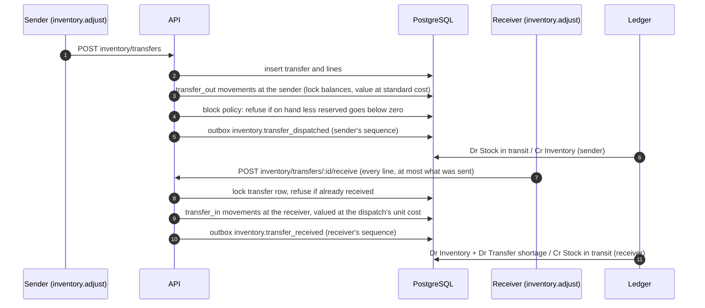

# Inventory and financial correctness

This document explains how KitchOS keeps stock, cash and the books consistent, and how that is
checked. The rules are enforced in the database where possible, because application code can be
bypassed or have bugs, while a constraint or trigger applies to every writer. The detailed reasoning
is in the ADRs cited in each section.

## Stock: one fact, recorded once (ADR-0006)

- `stock_movements` is the only source of truth for stock. Each row is one physical fact (a
  receipt, a consumption, waste, a count adjustment, a transfer) and can never be changed or
  deleted. Mistakes are corrected with new movements.
- `stock_balances` is a projection. Only an `AFTER INSERT` trigger on movements changes `on_hand`,
  so `on_hand = Σ quantity_delta` holds at all times, and tests assert it after every scenario.
- Every movement names its cause (`source_type`, `source_id`, `source_key`). A unique constraint
  over that cause, the item and the movement type turns a replay (a duplicate event, a double tap,
  a retried request) into an insert that does nothing.
- Each recipe version chooses when ingredients are consumed: when the order is accepted, when its
  kitchen task starts, or when it completes. A line is consumed exactly once at that point.
- Orders reserve stock when placed. Under the `block` policy an order that would oversell is
  refused, and the check runs on balance rows locked in ascending item order, so concurrent orders
  cannot both take the last unit. Under `allow_negative` the order goes through and on-hand can go
  negative. Movements are never dropped for lack of stock.
- Cancelling after consumption does not put stock back; the food is recorded as waste instead
  (ADR-0011, Milestone 14).

## Waste: physical and financial kept apart (ADR-0011)

Waste of raw stock deducts it. Waste of food that was already consumed into an order does not
deduct it again; it only moves its cost from COGS to Waste expense. A remake consumes a new portion.
Waste above a restaurant threshold needs approval by someone other than the person who recorded it,
and a rejection reverses it at the original value.

## Value on every movement (ADR-0016)

A `BEFORE INSERT` trigger stamps each movement with the item's standard unit cost at that moment
and its signed value in cents (rounded half away from zero). Callers cannot supply or change it,
and later cost changes do not revalue history. The journal is posted from these recorded values.

| Operation            | Journal entry                                                               |
| -------------------- | --------------------------------------------------------------------------- |
| Consumption          | Dr COGS, Cr Inventory                                                       |
| Waste                | Dr Waste expense, Cr Inventory, or Cr COGS when already consumed            |
| Rejected waste       | The reverse, at the original value                                          |
| Goods receipt        | Dr Inventory, Cr Goods received not invoiced                                |
| Stock count          | Shrinkage Dr Stock count variance, Cr Inventory (a gain the reverse)        |
| Opening stock (seed) | Dr Inventory, Cr Opening balance equity                                     |
| Transfer dispatched  | Dr Stock in transit, Cr Inventory, at the sender                            |
| Transfer received    | Dr Inventory and Dr Transfer shortage, Cr Stock in transit, at the receiver |

## Stock transfers (ADR-0019)

Because arrival is valued at the dispatch's cost, Stock in transit clears exactly for every
received transfer, even if the standard cost changed in between. It nets to zero across the
organisation, not per restaurant.

The sender can cancel a transfer that has not been received (ADR-0020). Its stock
comes back as `return_to_stock` movements, also valued at the dispatch's cost, and the sender posts
Dr Inventory / Cr Stock in transit, so a cancelled transfer leaves nothing in transit either. Cancel
and receipt lock the same transfer row and both require it to be in transit, so only one happens.
Each restaurant's daily reconciliation checks Stock in transit: the value it dispatched, less what
its cancels returned, less the dispatched value of transfers it received, against the journal.

## Money

- Money is integer cents in the database and in TypeScript (ADR-0004). Division only happens
  through `divRoundHalfUp`, `inclusiveTax` and `allocate` in `@kitchos/domain`, which work on
  integers and distribute remainders so that parts always sum to the whole.
- Prices are always computed by the server from the published menu version. Client totals are
  ignored.
- GST is computed once on the taxable order total (prices are GST inclusive) and spread over lines
  exactly, so a refund by item returns precisely that line's share.
- Cash totals round to 5 cents; the rounding is recorded on the payment, not the order.

## The journal (ADR-0013)

- Double entry, append-only. Deferred constraint triggers refuse any entry whose debits and
  credits differ at commit, and lines can only be added by the transaction that created the entry.
- One entry per `(source_type, source_id, entry_type)`, so a redelivered event cannot post twice.
- Entries are posted from events by one consumer that re-reads the source rows, never the event
  payload.
- Revenue and GST are recognised at handover. Payments before that are customer deposits.

## Cash (ADR-0015, ADR-0018)

- Every cash payment and refund belongs to an open drawer session, which belongs to one person and
  one drawer.
- Counts are blind: the person counting does not see the expected amount. Variances over a
  threshold need approval by someone who neither ran nor counted the drawer.
- Shifts group drawers and people. A shift closes only when all its drawers are counted and
  approved, and then stores an immutable snapshot. Rows are stamped with the open shift by trigger
  under a shared lock, so a row committed during a close is either in the snapshot or in no closed
  shift.

## Business-day close and reconciliation (ADR-0017)

`GET /v1/restaurants/:id/accounting/reconciliation?businessDate=` compares, for one restaurant and
business day:

| Operational side                                | Journal side                                         |
| ----------------------------------------------- | ---------------------------------------------------- |
| Net sales of completed orders                   | Sales revenue and discounts                          |
| GST of completed orders                         | GST payable                                          |
| Captured payments, and card and cash separately | Customer deposits, Card clearing, Cash on hand       |
| Cash rounding on payments and refunds           | Cash rounding                                        |
| Refunds                                         | Refund entries                                       |
| Σ value of valued stock movements               | Net change in Inventory                              |
| Σ variance of drawers closed that day           | Cash over/short                                      |
| Every receipt and refund entry                  | Exactly one payment or refund of that amount and day |
| Events that post to the day                     | None pending, none dead-lettered                     |

The day can only be closed when all of these agree, every drawer is counted and approved, the day
has ended and settled for 5 minutes. The close stores an immutable snapshot, and a closed day takes
no further entries: anything late is posted to the next open day and marked.

## How this is tested

- Integration tests assert persisted rows (movements, balances, journal lines, snapshots), not
  only HTTP responses.
- Concurrency tests race real requests (overselling, double receipt, shift close against a payment
  in flight) and are mutation-checked: removing the protection must make them fail.
- Adversarial test files, written independently for each milestone, try to break the invariants
  above and are kept as regressions.

## Known gaps

See [RISKS.md](../RISKS.md). The main ones: standard cost only, with no purchase price variance or
payables (R-022); a movement written outside the application without its event is valued but never
posted (R-023); reconciliation checks tender lines only inside receipt and refund entries (R-033);
transfers left in transit are not aged or flagged at day close (R-041).
