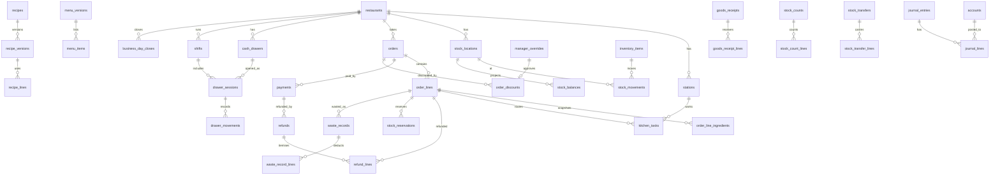

# Database architecture

PostgreSQL 18 is the system of record. The schema is plain SQL in numbered migrations
(`packages/database/migrations`), applied by a small runner that records a checksum for each file
and refuses to run if an applied file has changed (`packages/database/src/migrate.ts`). Kysely
types are generated from the live schema (`pnpm --filter @kitchos/database codegen`), and CI fails
if the committed types drift from the migrations.

## Roles and tenancy

| Role            | Used by                 | Rights                                                                                   |
| --------------- | ----------------------- | ---------------------------------------------------------------------------------------- |
| `kitchos_owner` | Migrations, seed, tests | Owns every table. Never used by the running API.                                         |
| `kitchos_app`   | The API at runtime      | `NOBYPASSRLS`, owns nothing. Granted per table and often per column, in migrations only. |

Every one of the 59 tables created by the migrations has row-level security enabled, with a
`tenant_isolation` policy on `org_id = app.current_org()`. The API sets `app.org_id` with
`set_config(..., true)` at the start of each transaction (`withTenant` in
`packages/database/src/client.ts`), so a query can only ever see one organisation. Foreign keys are
composite `(org_id, id)`, so a row cannot reference another tenant's row even through the owner
role.

Background work that has to find tenants first (the event dispatcher) does so through one narrow
`SECURITY DEFINER` function that returns organisation ids only, then works inside `withTenant`
(ADR-0013).

## Migrations

| File                                | Adds                                                                                                                      |
| ----------------------------------- | ------------------------------------------------------------------------------------------------------------------------- |
| `0001_foundation`                   | Tenancy, identity, catalog, versioned menus and recipes, orders, kitchen, stock ledger, outbox, inbox, idempotency, audit |
| `0002_runtime_grants`               | Least-privilege grants for `kitchos_app`                                                                                  |
| `0003_inventory_operations`         | Waste, goods receipts, physical counts, standard costs                                                                    |
| `0004_pos_cash_payments`            | Cash tender, change and rounding                                                                                          |
| `0005_discounts_and_overrides`      | Order discounts, manager overrides                                                                                        |
| `0006_ledger`                       | Chart of accounts, accounting periods, journal, consumer failures                                                         |
| `0007_refunds`                      | Refunds and payment reversal                                                                                              |
| `0008_cash_drawers`                 | Cash drawers, till sessions, drawer movements, blind counts                                                               |
| `0009_inventory_valuation`          | Value on every stock movement, inventory accounts and entry types                                                         |
| `0010_business_day_close`           | Business-day close, drawer administration, closed-day guard                                                               |
| `0011_item_refunds`                 | Refund lines (refunds by item)                                                                                            |
| `0012_shifts`                       | Shifts and shift stamping                                                                                                 |
| `0013_stock_transfers`              | Stock transfers (Milestone 19)                                                                                            |
| `0014_stock_transfer_receipt_guard` | Triggers keep a transfer receipt whole: every line recorded, none changed after (Milestone 19)                            |

## Core relationships

Drawn from the foreign keys in the migrations. Tenancy columns (`org_id`) and user references are
left out for readability.

Stock movements are linked to their cause by `(source_type, source_id, source_key)` rather than a
foreign key, because the cause can be an order line, a waste record, a receipt, a count or a
transfer. The unique constraint on that key plus the item and movement type is what makes replays
harmless.

## Rules the database enforces

| Rule                                                               | How                                                                                                                                                                                                                                  |
| ------------------------------------------------------------------ | ------------------------------------------------------------------------------------------------------------------------------------------------------------------------------------------------------------------------------------ |
| Ledgers never change                                               | `BEFORE UPDATE OR DELETE` triggers on `stock_movements`, `audit_log`, `order_line_ingredients`, the journal, receipts, counts and waste lines (plus `BEFORE TRUNCATE` on stock movements and the journal); no UPDATE or DELETE grant |
| Stock balances follow the ledger                                   | `AFTER INSERT` trigger on `stock_movements` (`SECURITY DEFINER`) is the only writer of `on_hand`                                                                                                                                     |
| Every movement carries its value                                   | `BEFORE INSERT` trigger sets `unit_cost` and `value_cents`; callers cannot supply them (ADR-0016)                                                                                                                                    |
| Journal entries balance                                            | Deferred constraint triggers check debits equal credits at commit; lines can only be added by the transaction that created the entry                                                                                                 |
| One entry per source and type                                      | `UNIQUE (org_id, source_type, source_id, entry_type)` on `journal_entries`                                                                                                                                                           |
| Closed periods and closed days take no entries                     | `BEFORE INSERT` guards on `journal_entries`; a late entry is moved to the next open day and marked (ADR-0017)                                                                                                                        |
| Published menus and recipes are immutable                          | Triggers on the version tables                                                                                                                                                                                                       |
| One open shift per restaurant; closed shifts never change          | Partial unique index and a guard trigger (ADR-0018)                                                                                                                                                                                  |
| Orders, payments, refunds, discounts and sessions know their shift | `BEFORE INSERT` stamping trigger under a shared advisory lock (ADR-0018)                                                                                                                                                             |
| A transfer is received once, and arrives at its dispatch cost      | Guard triggers on transfers and lines; valuation trigger reads the dispatch's cost (ADR-0019)                                                                                                                                        |
| Sign of a movement matches its type                                | `CHECK` on `stock_movements`                                                                                                                                                                                                         |

## Data types

- Money is `bigint` cents (ADR-0004). There are no floating-point money columns.
- Quantities are `numeric(18,3)` and travel as decimal strings; TypeScript works in integer
  milli-units.
- Unit costs are `numeric(18,6)` cents per base unit.
- Primary keys are UUIDv7 (`uuidv7()`), so they sort by creation time.

## Known limits

- `outbox_events` and `idempotency_keys` grow without bound; there is no retention job yet (R-008).
- Some links are enforced by the service rather than a constraint, for example that a transfer's
  locations belong to its restaurants (ADR-0019) and that a refund line belongs to the refunded
  order (R-037).
