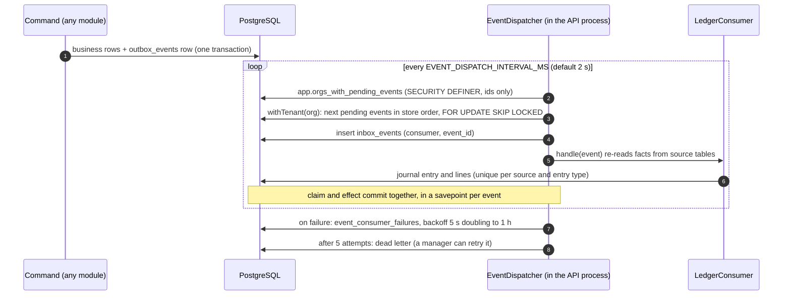
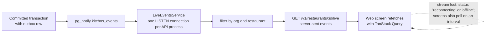

# Events and live updates

KitchOS uses events for two different jobs, and keeps them apart:

1. **Durable consequences.** The journal is posted from events, exactly once, even if the API
   crashes between the business change and the posting.
2. **Live screens.** Kitchen, expo, pickup and back-office screens refresh within moments of a
   change.

Both start from the same row in `outbox_events`.

## The transactional outbox (ADR-0008)

A command writes its business rows and its events in one transaction (`appendEvents` in
`apps/api/src/events/outbox.ts`). The event row gets the next value of a gap-free, per-restaurant
`store_sequence`, taken from `restaurant_event_sequences` under a row lock. Taking that lock last is
part of every path's lock order, which is why outbox events are appended at the end of a command.

If the transaction rolls back, the event never existed. If it commits, the event is durable. There
is no window in which a change is saved but its event is lost, or the reverse.

## Delivery to the ledger (ADR-0013)

What makes this exactly once:

- the inbox row `(consumer, event_id)` is inserted in the same transaction as the journal entry;
- journal entries are unique per `(source_type, source_id, entry_type)`, so even a handler called
  twice cannot post twice (tested by redelivering events);
- `SKIP LOCKED` lets several API replicas run the loop without taking the same event.

Handlers never trust the event payload for amounts. They re-read the orders, payments, refunds,
drawer sessions and stock movements the event points at.

A failing event does not block the ones behind it. Day close refuses to close a day while any of
its events is still pending (`LEDGER_BEHIND`) or has failed (`LEDGER_FAILED`), and a manager can put
a dead event back in the queue
(`POST /v1/restaurants/:id/accounting/failed-events/:eventId/retry`).

## Event catalogue

Emitted by the API (from `appendEvents` calls in `apps/api/src`):

| Event                                                        | Emitted by       | Consumed by the ledger as                                                       |
| ------------------------------------------------------------ | ---------------- | ------------------------------------------------------------------------------- |
| `order.placed`, `order.discounted`                           | Ordering         | Not consumed (live screens only)                                                |
| `order.accepted`                                             | Payment capture  | COGS for lines consumed at acceptance                                           |
| `order.in_preparation`, `order.ready`, `order.completed`     | Kitchen, handoff | `order.completed`: sale recognition                                             |
| `order.cancelled`                                            | Cancellation     | Not consumed directly                                                           |
| `payment.captured`, `payment.failed`                         | Payments         | `payment.captured`: payment receipt                                             |
| `payment.refunded`                                           | Refunds          | Refund                                                                          |
| `kitchen.task.queued`, `.started`, `.completed`              | Kitchen          | Started or completed: COGS for that line, if it is the line's consumption point |
| `inventory.waste_recorded`, `inventory.waste_rejected`       | Waste            | Waste, waste reversal                                                           |
| `inventory.goods_received`                                   | Receipts         | Goods receipt                                                                   |
| `inventory.counted`                                          | Counts           | Stock count variance                                                            |
| `inventory.opening_stock`                                    | Seed only        | Opening stock                                                                   |
| `inventory.transfer_dispatched`, `.transfer_received`        | Transfers        | Stock in transit, transfer receipt and shortage                                 |
| `inventory.transfer_cancelled`                               | Transfer cancel  | Stock in transit cleared back into the sender's Inventory                       |
| `drawer.opened`, `drawer.movement_recorded`, `drawer.closed` | Cash drawers     | Float, paid in and out, safe drop, close                                        |
| `business_day.closed`                                        | Day close        | Not consumed                                                                    |

Order status events are built as `order.${status}` in `kitchen.service.ts`, so the order events
above follow the order state machine.

## Live updates

`outbox_events` has an `AFTER INSERT` trigger that calls `pg_notify('kitchos_events', ...)` with the
event id, tenant, restaurant, sequence and type. PostgreSQL delivers a notification only when the
transaction commits, so screens never see a rolled-back change.

The notification is only a wake-up signal. Screens refetch from the API, and the live screens
also poll on a timer (the kitchen display every 10 seconds), so a missed notification costs
latency, not correctness. The LISTEN connection uses keepalive and reconnects if the socket
goes half open.

## Limits

- The dispatcher runs inside the API process. There is no separate worker and no external bus
  (EventBridge, SQS or similar). `published_at` is never set (R-002).
- The dispatcher scans the outbox with anti-joins each pass, so its cost grows with history (R-015).
- The outbox is never pruned (R-008).
- Event payloads are versioned (`event_version`) but no consumer outside the API exists yet.
