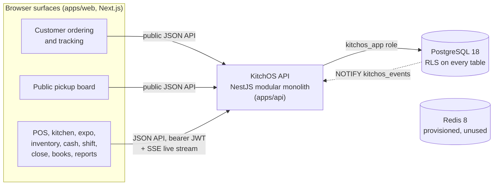
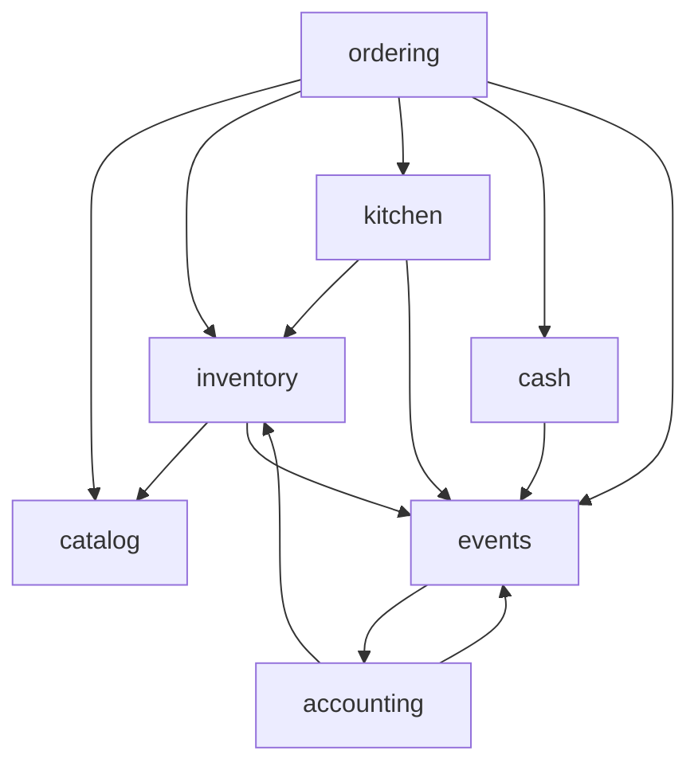
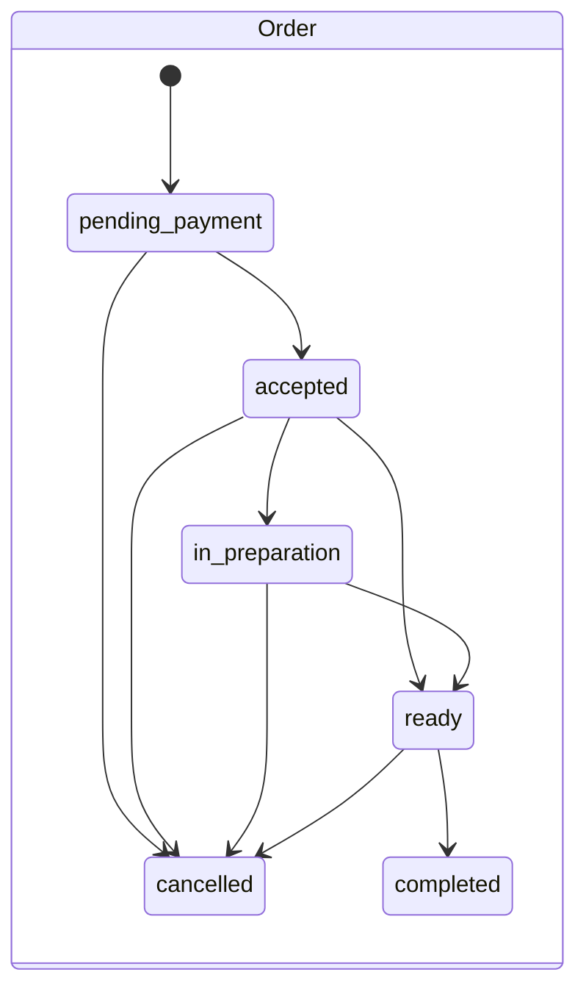
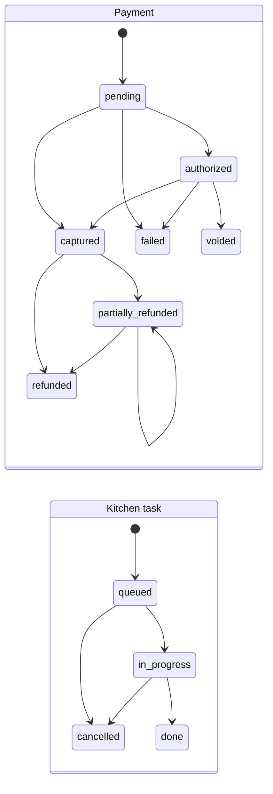

# KitchOS architecture overview

Living document. It describes what is implemented unless a passage is marked _planned_. Updated
14 November 2026 against commit `d9d83ff` and the Milestone 19 work, since committed.

## 1. Shape of the system today



Every client talks to one API process. The API is stateless apart from an in-process rate limiter
and the event dispatcher loop, both described below. There is no store-edge runtime yet; see
[offline.md](offline.md).

ADR-0001 records the intended two-plane design (a cloud control plane and a per-restaurant
execution plane). Only the cloud side exists today.

## 2. Modules

| Module     | Owns                                                                                   | Code                                                  |
| ---------- | -------------------------------------------------------------------------------------- | ----------------------------------------------------- |
| Identity   | Users, role assignments, JWT sessions, permission resolution per restaurant            | `apps/api/src/auth`                                   |
| Tenancy    | Organisation, brand, region, restaurant, station, device; `withTenant`                 | migration `0001`, `packages/database/src/client.ts`   |
| Catalog    | Products, versioned recipes and menus, modifiers, combos, availability                 | `apps/api/src/catalog`, `packages/domain/src/menu.ts` |
| Ordering   | Orders, pricing, payments, discounts, manager overrides, cancellation, refunds         | `apps/api/src/ordering`                               |
| Kitchen    | Station routing, kitchen tasks and their commands                                      | `apps/api/src/kitchen`                                |
| Inventory  | Stock ledger, balances, reservations, consumption, waste, receipts, counts, transfers  | `apps/api/src/inventory`                              |
| Cash       | Cash drawers, till sessions, blind counts, variance approval, shifts                   | `apps/api/src/cash`                                   |
| Accounting | Journal, posting rules, reconciliation, business-day close, food cost and item reports | `apps/api/src/accounting`                             |
| Events     | Transactional outbox, in-process dispatcher, live events over SSE                      | `apps/api/src/events`                                 |

Business rules with no framework or database dependency (money, quantities, pricing, recipe
explosion, state machines, journal posting rules) live in `packages/domain` and are unit and
property tested.

Module dependencies, from the imports in `apps/api/src` (`infra` and `auth` omitted, since almost
every module uses them):



The `events` and `accounting` cycle is deliberate: the dispatcher in `events` delivers to the
ledger consumer in `accounting`, and accounting reads the outbox to report posting backlog.

## 3. Order, kitchen and inventory flow

```mermaid
sequenceDiagram
  autonumber
  participant C as Customer or POS
  participant API as API (one transaction per step)
  participant DB as PostgreSQL
  participant K as Kitchen display

  C->>API: POST orders (Idempotency-Key)
  API->>DB: price from the published menu version, allocate order number
  API->>DB: insert order, lines, modifiers, ingredient snapshot
  API->>DB: lock balances in item order, check available, reserve
  API->>DB: outbox order.placed (next store_sequence)
  API-->>C: 201 pending_payment

  C->>API: POST payments (sandbox token or cash tender)
  API->>DB: payment captured, order accepted
  API->>DB: route lines to stations as kitchen tasks
  API->>DB: consume lines whose consumption point is order_accepted
  DB--)K: NOTIFY after commit, SSE, client refetches

  K->>API: POST tasks/{id}/start
  API->>DB: lock order, lock task, version check
  API->>DB: consume (point task_started), ON CONFLICT DO NOTHING
  K->>API: POST tasks/{id}/complete
  API->>DB: consume (point task_completed); all tasks done, order ready
  K->>API: POST orders/{id}/handoff, order completed exactly once
```

## 4. State machines

Defined in `packages/domain/src/state-machine.ts`. Every change goes through the machine and a
version-checked `UPDATE`.





## 5. Key correctness mechanisms

| Invariant                                  | Mechanism                                                                                                                                                       |
| ------------------------------------------ | --------------------------------------------------------------------------------------------------------------------------------------------------------------- |
| Inventory consumption is idempotent        | `stock_movements_source_unique (org, source_type, source_id, source_key, item, type)` and `ON CONFLICT DO NOTHING`                                              |
| Ledgers are append-only                    | `BEFORE UPDATE/DELETE/TRUNCATE` triggers, and the runtime role has no UPDATE or DELETE grant on them                                                            |
| Balances reconcile to the ledger           | `on_hand` changes only through a `SECURITY DEFINER` trigger on movement insert; reconciliation asserted in tests                                                |
| No overselling                             | `SELECT ... FOR UPDATE` on balance rows in ascending item id; the per-store order counter also serialises placement                                             |
| Orders keep historical versions            | `orders.menu_version_id`, `order_lines.recipe_version_id`, immutable `order_line_ingredients`; published versions immutable                                     |
| Valid state transitions                    | Domain state machines and conditional `UPDATE ... WHERE version = ?`                                                                                            |
| Payment state is separate from order state | Separate `payments` table and machine; one successful payment per order (partial unique index)                                                                  |
| Tenant isolation                           | RLS on every table, `app.org_id` set per transaction, restricted runtime role                                                                                   |
| Duplicate requests                         | `idempotency_keys` row inserted in the same transaction as the effect                                                                                           |
| No deadlocks between paths                 | Fixed lock orders: order, kitchen task, stock balances, event sequence (ADR-0006); order, payment, shift lock, drawer session, stock, event sequence (ADR-0018) |
| Journal agrees with operations             | Postings derived from recorded facts, one entry per source and type, daily reconciliation (see [correctness.md](correctness.md))                                |

## 6. Deployment

Today KitchOS runs locally (Docker Compose for the databases, `pnpm dev` for the apps) and in
GitHub Actions. Nothing is hosted. The reference cloud design is _planned_; see
[operations/deployment.md](../operations/deployment.md).
