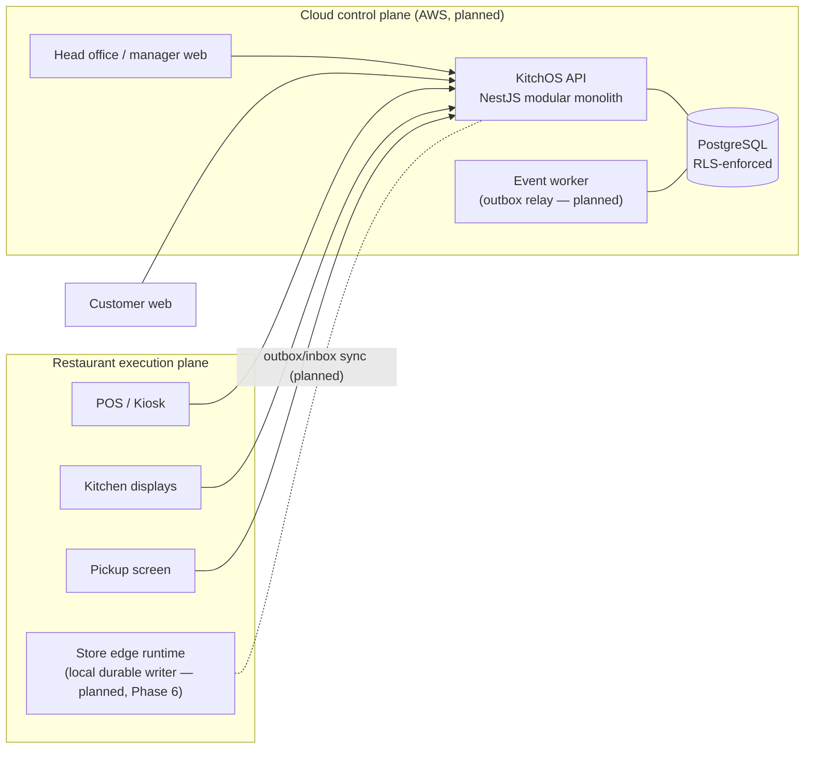

# KitchOS architecture overview

> Status: living document. Reflects what is **implemented** unless marked _planned_.

## 1. Shape of the system

KitchOS is two connected planes (see ADR-0001):



Today every client talks to the cloud API directly. Phase 6 introduces the store-edge runtime as
the single operational writer per restaurant, syncing to the cloud through the same outbox/inbox
contracts already in the schema (`outbox_events.store_sequence`, `inbox_events`).

## 2. Bounded contexts (implemented)

| Context   | Owns                                                                  | Code                                           |
| --------- | --------------------------------------------------------------------- | ---------------------------------------------- |
| Identity  | users, role assignments, JWT sessions, permission resolution          | `apps/api/src/auth`                            |
| Tenancy   | organisation → brand → region → restaurant → station → device         | schema `0001`, `withTenant`                    |
| Catalog   | products, versioned recipes, versioned menus, modifiers, availability | `apps/api/src/catalog`, `packages/domain/menu` |
| Ordering  | orders, lines, pricing, payments (sandbox), order state machine       | `apps/api/src/ordering`                        |
| Kitchen   | station routing, kitchen tasks, task state machine                    | `apps/api/src/kitchen`                         |
| Inventory | stock ledger, balances projection, reservations, consumption          | `apps/api/src/inventory`                       |
| Events    | transactional outbox, store sequencing, live fan-out                  | `apps/api/src/events`                          |

Pure business rules (pricing, recipe explosion, money, state machines) live in
`packages/domain` with no framework or database dependency, and are unit/property tested.

## 3. Order → kitchen → inventory flow

```mermaid
sequenceDiagram
  autonumber
  participant C as Customer
  participant API as API (one DB transaction per step)
  participant DB as PostgreSQL
  participant K as Kitchen display

  C->>API: POST /public/restaurants/{slug}/orders (Idempotency-Key)
  API->>DB: price from published menu version; allocate order number
  API->>DB: insert order + lines + modifiers + ingredient snapshot
  API->>DB: lock balances (sorted) → check available → reserve
  API->>DB: outbox order.placed (store_sequence n)
  API-->>C: 201 pending_payment + public token

  C->>API: POST /public/orders/{token}/payments (sandbox token)
  API->>DB: payment captured → order accepted
  API->>DB: route lines to stations → kitchen_tasks
  API->>DB: consume lines whose point = order_accepted
  DB--)K: NOTIFY (after commit) → SSE → refetch

  K->>API: POST tasks/{id}/start
  API->>DB: lock order → lock task → version check
  API->>DB: consume (point = task_started) — ON CONFLICT DO NOTHING
  K->>API: POST tasks/{id}/complete
  API->>DB: consume (point = task_completed); all done → order ready
  K->>API: POST orders/{id}/handoff → completed (exactly once)
```

## 4. Key correctness mechanisms

| Invariant                                     | Mechanism                                                                                                                   |
| --------------------------------------------- | --------------------------------------------------------------------------------------------------------------------------- |
| Inventory consumption is idempotent           | `stock_movements_source_unique (org, source_type, source_id, source_key, item, type)` + `ON CONFLICT DO NOTHING`            |
| Ledger is append-only                         | `BEFORE UPDATE/DELETE/TRUNCATE` triggers + runtime role has no UPDATE/DELETE grant                                          |
| Balances reconcile to ledger                  | `on_hand` changed only by a `SECURITY DEFINER` trigger on movement insert; reconciliation query in tests                    |
| No overselling                                | `SELECT … FOR UPDATE` on balance rows in ascending item id order; per-store order counter also serialises placement         |
| Orders keep historical versions               | `orders.menu_version_id`, `order_lines.recipe_version_id`, immutable `order_line_ingredients`; published versions immutable |
| Valid state transitions                       | domain state machines + conditional `UPDATE … WHERE version = ?`                                                            |
| Payment ≠ order state                         | separate `payments` table/machine; one successful payment per order (partial unique index)                                  |
| Tenant isolation                              | PostgreSQL RLS on every tenant table, `app.org_id` set per transaction, restricted runtime role                             |
| Duplicate requests                            | `idempotency_keys` row inserted in the same transaction as the effect                                                       |
| No deadlocks between cancel and kitchen bumps | lock order is always: order → task → balances → event sequence                                                              |

## 5. Deployment (planned, Phase 0 infra / Phase 9 hardening)

Reference AWS architecture: CloudFront → ALB (multi-AZ) → ECS Fargate (stateless API replicas)
→ Aurora PostgreSQL (multi-AZ, PITR) ; Secrets Manager for credentials; Terraform for all
resources. **No paid resources are provisioned without explicit approval.** See
`docs/reliability/slo.md` for availability targets (targets, not claims).
