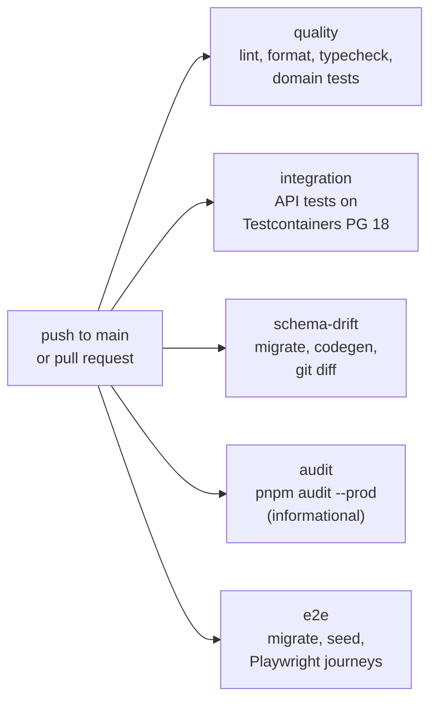
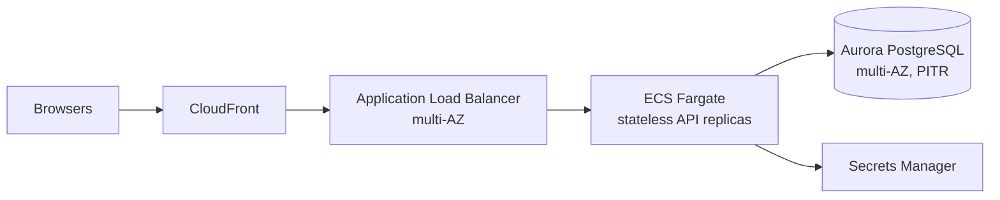

# Deployment

## Current state

KitchOS has **no hosted environment**. It runs in two places:

| Where                 | How                                                                                   |
| --------------------- | ------------------------------------------------------------------------------------- |
| A developer's machine | Docker Compose for PostgreSQL 18 and Redis 8; the API and web app run with `pnpm dev` |
| GitHub Actions        | Throwaway PostgreSQL service containers and Testcontainers; nothing is deployed       |

What does not exist yet:

- a container image for the API or the web app (there is no Dockerfile);
- a working API production build (`apps/api` has a `build` script naming tsup, but no tsup
  configuration and no verified output); the web app does build with `next build`;
- infrastructure as code (no Terraform);
- managed secrets, TLS termination, backups, monitoring dashboards or alerting.

## What the code already provides for operation

| Concern            | Provided                                                                                                                                     |
| ------------------ | -------------------------------------------------------------------------------------------------------------------------------------------- |
| Health             | `GET /health/live` (process up), `GET /health/ready` (503 unless the database answers; also reports the live-events connection)              |
| Metrics            | `GET /metrics` in Prometheus format, including an HTTP request duration histogram                                                            |
| Logs               | Structured JSON with pino, request ids, sensitive fields redacted                                                                            |
| Configuration      | Environment variables validated at start-up; the API refuses to start on invalid config                                                      |
| Database roles     | Owner for migrations, restricted runtime role for the API (see [database.md](../architecture/database.md))                                   |
| Schema changes     | Forward-only migrations with checksums; CI checks generated types against them                                                               |
| Horizontal scaling | Request handling is stateless and the event dispatcher uses `SKIP LOCKED`, so several replicas can run. Rate limits are per replica (R-007). |

## CI pipeline

The jobs run in parallel and none of them deploys anything.

## Planned reference architecture

Recorded in the implementation plan (Phase 0 and Phase 9). It is a plan, not a description of
anything running, and no paid resources will be created without explicit approval.

Open questions before any of this is built: how the web app is hosted, where the event dispatcher
runs once there is more than one replica, a shared rate limiter, outbox retention, backup and
restore drills, and the store-edge runtime for offline trading
([offline.md](../architecture/offline.md)). Availability targets in
[slo.md](../reliability/slo.md) are targets only.
