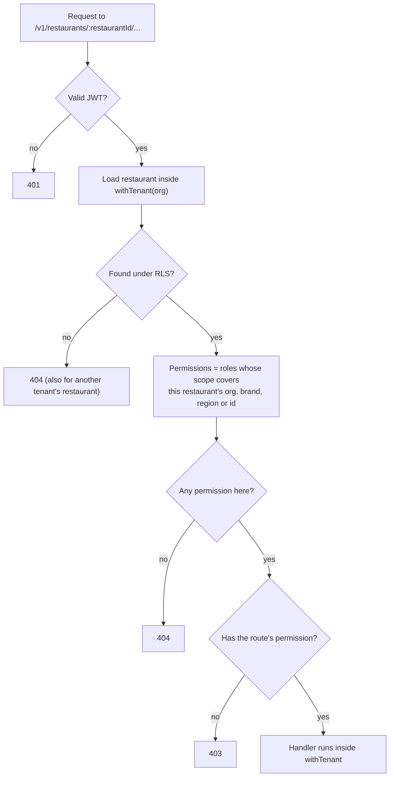

# Authentication, authorisation and tenant isolation

This describes the controls that exist in code. The threat model is in
[threat-model.md](threat-model.md); open issues are in [RISKS.md](../RISKS.md). Design reasoning is
in ADR-0005 (row-level security) and ADR-0009 (authentication).

## Who can call the API

| Caller         | How they identify                                    | What they can reach                                                          |
| -------------- | ---------------------------------------------------- | ---------------------------------------------------------------------------- |
| Guest customer | Nothing; an order is then reached by a 128-bit token | `/v1/public/*`: menus, placing and paying an order, its status, pickup board |
| Staff          | Email and password, then a bearer JWT                | `/v1/me` and `/v1/restaurants/:id/*`, filtered by role and scope             |
| Operations     | None                                                 | `/health/live`, `/health/ready`, `/metrics`                                  |

There is no device identity, staff PIN, MFA or single sign-on yet.

## Sign-in

- Passwords are hashed with argon2id (`@node-rs/argon2`). Unknown accounts take the same path and
  return the same error as a wrong password, so accounts cannot be enumerated.
- Failed attempts are limited per account (10 per 15 minutes, whatever the client IP) and every
  attempt counts against a per-IP ceiling (100 per 15 minutes). Manager re-authentication on a
  terminal shares the per-account budget and adds a per-requester budget. Denied attempts are
  audited.
- These limits live in the API process (`apps/api/src/infra/rate-limit.ts`). With more than one
  replica each keeps its own count (R-007). Redis is provisioned locally for a shared limiter but
  not used yet.

## Tokens

- HS256 JWT signed with `AUTH_JWT_SECRET` (at least 32 characters, checked at start-up), issuer
  `kitchos-api`, audience `kitchos-staff`, valid for 8 hours.
- The token carries only the user and organisation. Role assignments are reloaded from the
  database on every request, so revoking a role takes effect immediately.
- There is no refresh token, rotation or revocation list (R-003). The web app keeps the token in
  `sessionStorage` for one tab and never in `localStorage`.

## Authorisation

Permissions are fine-grained (`orders.create`, `inventory.adjust`, `cash.manage`, `day.close` and
so on; see `apps/api/src/auth/permissions.ts`). Roles map to permission sets, and each role
assignment has a scope: the whole organisation, a brand, a region or one restaurant.

- A restaurant in another tenant, or one the user has no role at, is indistinguishable from one
  that does not exist (404). Within a restaurant the user can see, a missing permission is 403.
- Some rules depend on the record as well as the role, and are checked in the service: cancelling
  after preparation needs `orders.cancel_after_prep`; a variance must be approved by someone who
  neither ran nor counted the drawer; waste above the threshold needs a different approver; a
  manager override is bound to one restaurant, order, requester and exact discount, is single use
  and expires after 2 minutes.
- `platform_administrator` has no tenant permissions at all.

## Tenant isolation in the database

The API connects as `kitchos_app`, which owns no table and cannot bypass row-level security. Every
transaction sets `app.org_id`, and every table has a policy limiting rows to that organisation.
Even a bug that forgets a `WHERE org_id = ...` cannot return another tenant's rows. Integration
tests check this from both the HTTP side and directly against the runtime role.

## Other controls

| Control             | Detail                                                                                                                             |
| ------------------- | ---------------------------------------------------------------------------------------------------------------------------------- |
| Input validation    | Zod schemas on every body, query and path parameter; unknown fields are dropped                                                    |
| Server-side pricing | Totals are always computed from the published menu; client prices are ignored                                                      |
| Card data           | Token-only sandbox payments; input shaped like a card number is rejected                                                           |
| Idempotency         | `Idempotency-Key` required on commands that create effects; a reused key with a different body is refused                          |
| Audit               | Append-only `audit_log` for cancellations, discounts, overrides, refunds, drawers, shifts, stock operations, day close and retries |
| Log redaction       | `authorization`, cookies, passwords and payment tokens are redacted by pino                                                        |
| Query limits        | 10 second statement timeout on the runtime pool                                                                                    |
| CORS                | Only origins in `CORS_ORIGINS`; bearer tokens, no cookies                                                                          |
| Dependency audit    | `pnpm audit --prod` in CI, informational (not gating)                                                                              |

## Not done

MFA, OIDC, device identity and staff PINs; a shared rate limiter; token rotation; security headers
on the web app; an audit log viewer; an OWASP ASVS review (Phase 9). Blind cash counts can be
partly undermined through the crew order list (R-040).
