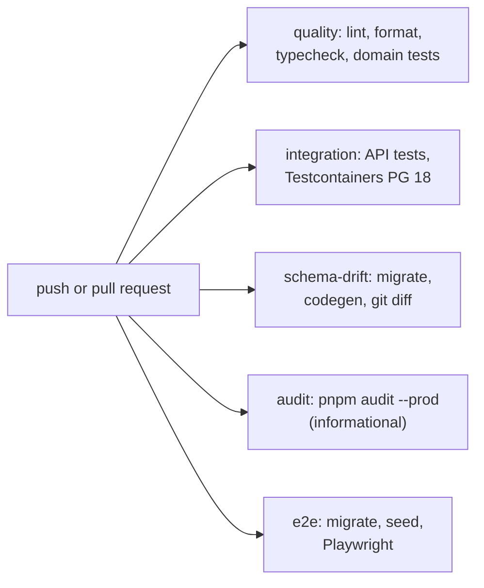

# Testing strategy

| Layer             | Tooling                                    | Scope                                                                                |
| ----------------- | ------------------------------------------ | ------------------------------------------------------------------------------------ |
| Domain unit       | Vitest + fast-check                        | Money, rounding, allocation, quantities, pricing, recipe explosion, state machines   |
| API integration   | Vitest + Supertest + Testcontainers (PG18) | Full HTTP flows against real migrations, seed, RLS and the restricted runtime role   |
| Database          | Same harness                               | Append-only and immutability triggers, grants, reconciliation of projections         |
| E2E               | Playwright (Chromium)                      | 10 journeys through the real UI, API and database, locally and in the CI `e2e` job   |
| Load (planned)    | k6                                         | Order placement and kitchen commands; reports must state hardware, data, concurrency |
| Reliability (pl.) | Fault injection                            | Process kill mid-transaction, DB failover, duplicate/out-of-order events, WAN loss   |

## Current suites

Counted on 14 November 2026, including the Milestone 20 files.

| Suite                      | Files | Tests | Last result                                              |
| -------------------------- | ----- | ----- | -------------------------------------------------------- |
| `@kitchos/domain`          | 12    | 64    | 64 passed                                                |
| `@kitchos/api` integration | 35    | 521   | 521 passed (one full shuffled run, seed `1794654793912`) |
| Playwright journeys        | 10    | 16    | 16 passed, on a local database reused across runs        |

Earlier on 14 November, on a local database reused across days, three journeys failed (the
`inventory.spec.ts` waste journey and two in `order-journey.spec.ts`). Order numbers restart each
business day, and those tests picked orders by number, so each found two orders with the same
number. The journeys now find orders on staff screens by id: order cards, kitchen tickets, expo
cards and waste records carry `data-order-id`, and waste records return `orderId`. All of them
then passed on the reused database too. The public pickup board is still matched by number; it lists
only the current business day, where numbers are unique.

Integration test files come in pairs for most features: a file written with the feature, and an
`-adversarial` file written independently to try to break it.

## CI

`.github/workflows/ci.yml` runs on every push to `main` and every pull request:



## Independent review

Each milestone is reviewed by independent subagents: a code reviewer (report only) and an
adversarial tester that writes a separate test file and must not weaken assertions to make them
pass. Genuine defects they find are fixed and their tests kept as regressions.

## Principles

- Assert on **persisted state** (ledger rows, balances, outbox, audit), not only HTTP responses.
- Every concurrency test is **mutation-checked**: we remove the protecting mechanism and confirm
  the test fails. Example: removing `FOR UPDATE` in `InventoryService.reserve` makes the
  "reservation row locks alone prevent overselling" test fail (6 of 6 reservations succeed
  against 2 units).
- Ledger reconciliation (`on_hand = Σ movements`, `reserved = Σ active reservations`) is asserted
  after every inventory scenario.
- Tests share one seeded database per run and assert on deltas, so files run serially.

## Running

```bash
pnpm db:up                      # local Postgres/Redis (only needed for running the app)
pnpm --filter @kitchos/domain test
pnpm --filter @kitchos/api test # starts its own PostgreSQL 18 container via Testcontainers
pnpm test:e2e                   # needs pnpm db:up/migrate/seed; starts API (:4000) and web (:3100)
```
